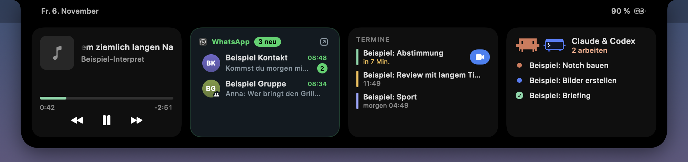

## Hallo, ich bin Maik.

Ich bin CTO bei [FBS Solution](https://fbs-solution.de) und verantworte dort die Technik: Websites für unsere Kunden, die internen Werkzeuge für Recruiting, Tracking und Video sowie deren Betrieb. Gebaut wird fast alles gemeinsam mit Claude Code.

English: CTO at FBS Solution. I build websites, internal tools and macOS apps, mostly together with Claude Code.

### Schwerpunkt

- **Websites**, die schnell laden und in Suchmaschinen ebenso gefunden werden wie in KI-Antworten. 
      
- **Interne Werkzeuge**: Portale, Tracking und Automatisierungen, die dem Team jeden Tag Arbeit abnehmen. 
    
- **macOS-Apps** in Swift und SwiftUI, nah am System und ohne Umweg über fremde Server. 
    
- **Arbeiten mit KI-Agenten**: Claude Code und Codex mit eigenen Skills, Hooks und Prüfroutinen. 
  

### Aktuelles Projekt: Claude Pet

**[Claude Pet](https://github.com/Maiki09k/claude-pet)** macht die Kamera-Notch am MacBook zur Statusanzeige. Sie zeigt live, ob Claude Code oder Codex gerade arbeiten, fertig sind oder etwas fragen, und Claudes Fragen lassen sich direkt in der Notch beantworten. Dazu kommen Musik, der nächste Termin und WhatsApp. Native in Swift und SwiftUI, alles läuft lokal, Open Source unter MIT-Lizenz.

[Zum Repository](https://github.com/Maiki09k/claude-pet)
